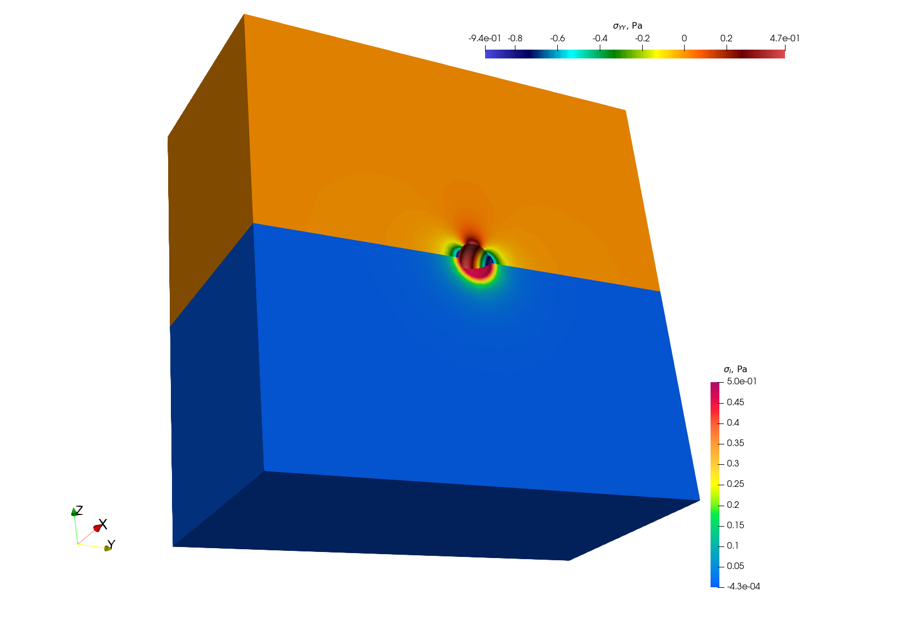
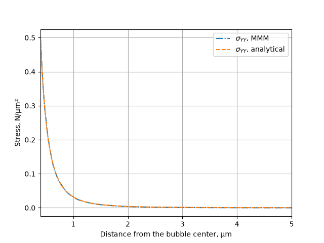

# Simulation of pressurized bubbles



## Problem description

The default example consists of a single spherical porosity in a quasi-infinite medium. The finite element solution can be compared with an analytical solution giving the elastic stress field as a function of the internal pressure, the bubble radius, and the distance from the bubble. As mentioned above, the boundary conditions for the problem are periodic, and we consider a zero macroscopic displacement gradient, which in turn generates a uniform compressive hydrostatic pressure on the REV. In this case with one porosity in a quasi-infinite medium, the compressive hydrostatic pressure is negligible, in agreement with the analytical solution mentioned above.

### Modify the geometry for the single bubble case and mesh it

The geometry for the test case is contained in the `.geo` file stored in the `mesh` folder, and considers a sphere of radius equal to 400 nm at the centre of a (periodic) cube with a side of 10 µm. For easier handling of the geometry and of the mesh, the units in the geometry file are expressed in <b>µm</b>. One can modify it and use it as an input for `gmsh` to generate the computational mesh for the case by running 

```bash
gmsh -3 single_sphere.geo
```

A `.msh` file is already provided in the folder `mesh`, generated based on the aforementioned geometry file. We have seen some slight differences in the final mesh depending on the version of `gmsh` employed.

N.B.: if the bubble center, radius, or the surface label are modified, the corresponding data stored in `single_bubble.txt` must also be changed.
N.B. bis: `single_bubble_ci.txt` and `mesh_sphere.msh` are used for GitHub continuous integration. This coarser mesh is generated by `gmsh -3 -clscale 3 single_sphere.geo -o mesh_sphere.msh` (gmsh 4.15.2).

## Set up the physical problem

The simulation considers an empty (i.e., not meshed) cavity, on whose surface we impose an arbitrary uniform pressure (equal to one by default). The medium is described by a purely elastic constitutive relationship, characterized by two elastic constants 

 - E = 150.10<sup>-3</sup> N µm<sup>-2</sup>
 - $$\nu = 0.3$$

The elastic modulus is rescaled to consistently describe the geometry in micrometers, rather than in SI units. This choice is made to facilitate the creation of more complex geometries when using `Mérope`, given the characteristic length scale of the considered inclusions.

The geometry is meshed using quadratic elements, to better describe the spherical inclusions contained in the representative elementary volume (REV). Although `MFEM` allows sub-, super-, and isoparametric analyses, we recommend sticking at least to the isoparametric choice (i.e., not subparametric) for the polynomial shape functions.

The boundary conditions for the problem are periodic, and we consider a zero macroscopic displacement gradient, which in turn generates a uniform compressive hydrostatic pressure on the REV.

### Parameters

Command-line Usage

```
Usage: ./test-bubble [options] ...
```


| Option                                    | Type   | Default                  | Description                                 |
| ----------------------------------------- | ------ | ------------------------ | ------------------------------------------- |
| `-h, --help`                              | —      | —                        | Print the help message and exit.            |
| `-m <string>, --mesh <string>`            | string | `mesh/single_sphere.msh` | Mesh file to use.                           |
| `-pm <int>, --parallel-mesh <int>`        | int    | `0`                      | Read a parallel mesh or not.                |
| `-l <string>, --library <string>`         | string | `src/libBehaviour.so`    | Material behaviour library.                 |
| `-f <string>, --bubble-file <string>`     | string | `mesh/single_bubble.txt` | File containing the bubble definitions.     |
| `-o <int>, --order <int>`                 | int    | `2`                      | Finite element order (polynomial degree).   |
| `-r <int>, --refinement <int>`            | int    | `0`                      | Refinement level of the mesh.               |
| `-p <int>, --post-processing <int>`       | int    | `1`                      | Run the post-processing step.               |
| `-v <int>, --verbosity-level <int>`       | int    | `0`                      | Verbosity level of the output.              |
| `-sf <double>, --scale-factor-vp <double>`| double | `0.9`                    | Scaling factor for the principal stress.    |
| `-n <string>, --name-case <string>`       | string | `TestCaseBubble`         | Name of the test case.                      |
| `-dm <double>, --dmin <double>`           | double | `0.950`                  | Distance to evaluate bubble rupture.        |
| `-pr <double>, --pref <double>`           | double | `1`                      | Internal bubble pressure in Pa.             |

The command to execute the test case is

```bash
mpirun -n 6 ./test-bubble
```

Below we show a contour plot of the $$YY$$ component of the stress tensor (upper half of the cube) and of the first principal stress (bottom half of the cube).


## Verification against the analytical solution

The problem of a pressurized spherical inclusion in an infinite elastic medium has a closed-form solution for the hoop stress as a function of the distance from the sphere center:

$$
\sigma_{\theta\theta}(r) = \dfrac{p_{in}*R_b^3}{2r^3}
$$

where $p_{in}$ is the internal pressure and $R_b$ the bubble radius; the expression holds for $r>R_b$.

The script available in `verification/bubble` can be used to compare the analytical solution to the MMM one:

```bash
python3 mmm_vs_analytical.py 
```
The comparison between the computational results and the analytical solution is shown below.


